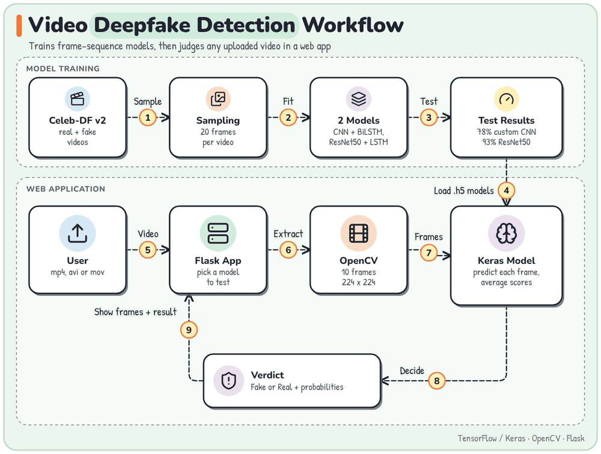

# Video Deepfake Detection

Trains frame-sequence models, then judges any uploaded video in a web app.

## Architecture

Follow the numbered steps. A sharp, scalable copy is in [`docs/architecture.svg`](docs/architecture.svg).

## Stack

TensorFlow / Keras, OpenCV, Flask
